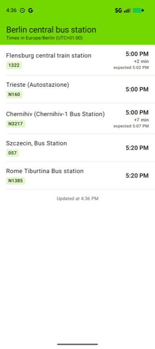
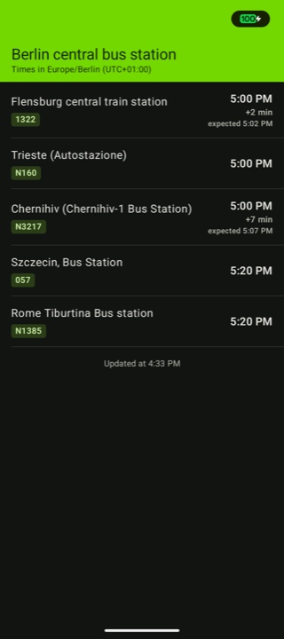
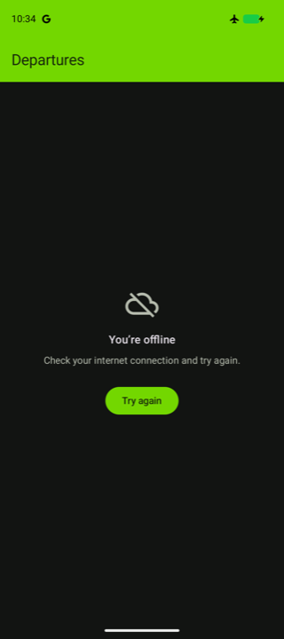
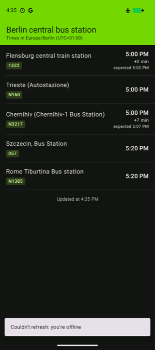
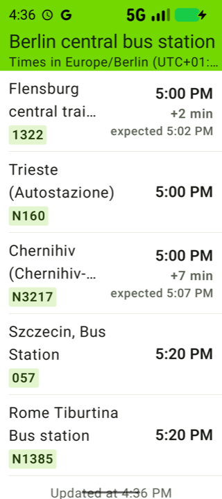

# Flix Departures

Android coding challenge: a live departures board for **Berlin central bus station** (ZOB). On launch the app shows
every bus leaving in the next two hours with its **line code**, **direction** and **departure time in the station's
time zone** — regardless of the time zone the phone is set to.

Business logic, networking and the screen's state live in a **Kotlin Multiplatform** module; the UI is native
Jetpack Compose.

| Light | Dark | Offline | Refresh failed | Font scale 200 % |
|---|---|---|---|---|
|  |  |  |  |  |

## Running

Requirements: JDK 17, Android SDK 37. Open the project in Android Studio and run `androidApp`, or:

```bash
./gradlew :androidApp:installDebug
```

The API key is configuration, not code. It is read from `-Pflix.apiKey=…`, `flix.apiKey=…` in `local.properties` or the
`FLIX_API_KEY` environment variable; the key from the challenge is the fallback so a fresh clone builds as is.
`flix.apiBaseUrl` and `flix.stationId` work the same way.

```bash
./gradlew check                             # ktlint, Android lint, all unit + UI tests
./gradlew :shared:iosSimulatorArm64Test     # the shared test-suite on an iOS simulator (macOS)
./gradlew :androidApp:assembleRelease       # R8-minified release build
```

## Architecture

```
shared/  (KMP: android · jvm · iosArm64 · iosSimulatorArm64)
  data/remote   Ktor client, DTOs                 ── wire format, nothing leaks upwards
  data          DeparturesMapper, repository     ── lenient DTO → domain mapping, exceptions → DataError
  domain        Timetable, Departure, Station,   ── pure Kotlin, the "now … now + 2h" rule
                GetUpcomingDeparturesUseCase
  presentation  TimetableViewModel, UI model     ── station-local times, day sections, refresh logic
  di            sharedModule(ApiConfig)          ── Koin; the host app only supplies config

androidApp/     Compose screen, theme, Koin bootstrap, BuildConfig → ApiConfig
```

- **Unidirectional data flow:** `TimetableViewModel` exposes one `StateFlow<TimetableUiState>`
  (`Loading` / `Error` / `Loaded`) plus a one-off `events` flow for snackbars. `TimetableScreen` is stateless; a thin
  `TimetableRoute` binds it to the ViewModel.
- **The ViewModel is shared** (`org.jetbrains.androidx.lifecycle`), so an iOS client would reuse not only the
  networking but the whole screen behaviour — only the view layer is per platform. The iOS targets compile and the
  full shared test-suite runs on the iOS simulator; an iOS UI is deliberately out of scope.
- **Time zones are handled in shared code.** The API returns UTC instants and an IANA zone for the station;
  `TimetableUiMapper` converts with `kotlinx-datetime`, so DST and midnight crossing are unit-tested once for every
  platform. The Android layer only formats a `LocalTime` according to the user's locale and 12/24-hour setting.
- **Errors are values.** The repository never throws: Ktor/serialization/IO exceptions become a typed `DataError`
  (`NoConnection`, `Timeout`, `Server`, `Client`, `InvalidResponse`, `Unknown`), each with its own message on screen.
  `CancellationException` is always rethrown.

## Behaviour and edge cases

| Situation | What happens |
|---|---|
| Phone in another time zone | Times stay in the station's zone; the app bar says which zone and its UTC offset. |
| Missing / unknown station time zone | Falls back to UTC **and says so** in the app bar instead of silently showing wrong times. |
| Window crosses midnight at the station | Sticky "Today · …" / "Tomorrow · …" headers appear; otherwise no headers. |
| Live delay data (`status.deviation`) | "+8 min · expected 17:08", red when the operator classifies the ride as late. |
| Ride without id, line code or a parseable time | Skipped (and logged), the rest of the board still renders; duplicates are removed. |
| Missing direction | "Direction not available" instead of an empty row. |
| Nothing departs in the next 2 h | Empty state with pull-to-refresh. |
| First load fails | Full-screen error tailored to the cause, with *Try again*. |
| Pull-to-refresh fails | Current list stays, snackbar explains why. |
| Board left open | Refreshes every 60 s (the API's `cache-control: max-age=60`) only while the screen is visible; on return after a pause it refreshes at once. |
| Transient 5xx / I/O errors | Retried twice with exponential back-off; parallel refresh requests are coalesced. |
| Logs | HTTP logging only in debug builds, with `apiKey` redacted. |
| Accessibility | Each row is one TalkBack node ("Line N160 to Trieste, departs at 17:20. 27 minutes late, expected at 17:47"); headings are marked; scales to 200 % font; dark theme; content on brand green is dark for contrast. |

## Tests

- `shared/commonTest` — runs on JVM, Android host and iOS simulator:
  - `DeparturesMapperTest` — a trimmed **real** API response plus broken rides, unknown zones, empty payloads.
  - `TimetableApiTest` — Ktor `MockEngine`: exact URL and query format, 4xx/5xx/malformed JSON/IO mapping, retries,
    API-key redaction.
  - `TimetableUiMapperTest` — CET/CEST, the DST switch night, midnight crossing, delay thresholds, UTC fallback.
  - `TimetableViewModelTest` — virtual-time tests with Turbine: loading → content, empty, error → retry, failed
    refresh keeps data, coalescing, auto-refresh lifecycle.
- `androidApp/src/test` — Robolectric Compose tests for every screen state, accessibility descriptions and time
  formatting.

## Tech stack

Kotlin 2.4 · Kotlin Multiplatform · Ktor 3 (OkHttp / Darwin) · kotlinx.serialization · kotlinx-datetime ·
Koin 4 · Jetpack Compose + Material 3 · Kermit · Turbine · Robolectric · ktlint · GitHub Actions

## What I would do next

- Offline cache (SQLDelight) so the last board survives process death and a cold start without network.
- Station picker (the station id is already configuration) and deep links to a station.
- A SwiftUI client on top of the shared ViewModel (SKIE for `StateFlow` → `AsyncSequence`).
- Screenshot tests (Roborazzi/Paparazzi) and a macrobenchmark + baseline profile for startup.
- Crash reporting and analytics behind the existing `Logger`.
